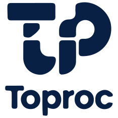

<div align="center">

<picture>
	<source media="(prefers-color-scheme: dark)" srcset="assets/branding/toproc-logo.light.svg" />
	
</picture>

_**Inventario de componentes** sobre **Toproc**, un backend orientado a transacciones._

[](#)
[](#)
[](#)
[](LICENSE)

</div>

Sistema para gestionar el inventario de componentes y equipos del laboratorio: inventario, ubicaciones, préstamos y devoluciones, reportes, notificaciones y administración de usuarios y permisos.

El sistema tiene dos repositorios:

- **[web-2-backend](https://github.com/EliabParra/web-2-backend)** (este): API, base de datos, instaladores y documentación de despliegue.
- **[web-2-frontend](https://github.com/EliabParra/web-2-frontend)**: interfaz web (React). En producción la compila y la sirve este backend.

## Instalar

Un solo comando instala todo (Docker incluido si falta), sin descargar los repositorios antes. La primera vez pregunta si se instala **en esta PC** o **en un servidor** de la red.

**Linux**

```bash
curl -fsSL https://raw.githubusercontent.com/EliabParra/web-2-backend/master/install.sh | bash
```

**Windows** (PowerShell como Administrador)

```powershell
irm https://raw.githubusercontent.com/EliabParra/web-2-backend/master/install.ps1 | iex
```

Al terminar muestra la URL y la contraseña del usuario `admin`. Para actualizar, se vuelve a ejecutar el mismo comando: los datos se conservan.

Modos, respaldos, comandos útiles y problemas comunes: **[docs/DEPLOY.md](docs/DEPLOY.md)**.

## Desarrollar

Resumen (detalle en **[docs/DEV.md](docs/DEV.md)**):

```bash
# Backend (este repositorio)
cp .env.example .env          # ajusta los valores indicados en docs/DEV.md
docker compose up -d db
pnpm install
pnpm run db sync --yes
pnpm run db seed --yes --seedAdmin --adminUser admin --adminPassword admin123 --profileId 3 --registerBo --txStart 1000 --seedPublicAuthPerms --publicProfileId 1
pnpm run dev                  # API en http://localhost:3000

# Frontend (en web-2-frontend)
npm install
npm run dev                   # http://localhost:5173
```

La instalación de producción (`~/toproc`) y el entorno de desarrollo pueden convivir en la misma PC. Lo único que comparten es el puerto 3000, así que no corras los dos a la vez.

## Cómo funciona

Toproc no expone endpoints REST por recurso: todo pasa por una sola ruta, `POST /toProccess`, con un número de transacción y sus parámetros:

```json
{ "tx": 1034, "params": {} }
```

- **Denegado por defecto**: una transacción que no está registrada y autorizada en la base de datos no existe.
- **Business Objects** (`BO/`): cada módulo (Inventory, Loan, User…) tiene su BO con validación Zod, servicio, repositorio y consultas SQL.
- **Permisos por perfil**: `1` público, `2` sesión, `3` super_admin.
- **Auditoría**: cada intento queda registrado con quién, cuándo y con qué parámetros.
- **Sesiones** en PostgreSQL y protección CSRF (`GET /csrf` devuelve el token, que se envía en `X-CSRF-Token`).

Los números de transacción se asignan al registrar los BOs (en orden alfabético, desde la 1000). El frontend los tiene en `src/api/tx.ts`.

## Scripts

| Script | Qué hace |
| :-- | :-- |
| `pnpm run dev` | Servidor de desarrollo con recarga automática. |
| `pnpm run verify` | Verificación completa: typecheck, build, smoke test y tests. |
| `pnpm test` | Tests (Node test runner). |
| `pnpm run db` | CLI de base de datos (`sync`, `seed`, `dml`, `bo`…). |
| `pnpm run bo <cmd>` | CLI para crear y sincronizar BOs. |
| `pnpm run config:check` | Valida el `.env` sin arrancar el servidor. |
| `pnpm run hashpw` | Hashea una contraseña manualmente. |
| `pnpm run docs:gen` | Genera la documentación de la API (TypeDoc). |

## Documentación del framework

- Primeros pasos: [estructura](docs/00-Introduction/FILE_STRUCTURE.es.md), [variables de entorno](docs/01-Getting-Started/ENVIRONMENT.es.md), [CLI](docs/01-Getting-Started/CLI_TOOLS.es.md), [crear un BO](docs/05-Guides/CREATE_NEW_MODULE.es.md)
- Arquitectura: [seguridad y permisos](docs/02-Architecture/SECURITY_SYSTEM.es.md), [AppServer](docs/02-Architecture/APPSERVER_CORE.es.md), [inyección de dependencias](docs/02-Architecture/DEPENDENCY_INJECTION.es.md), [sesiones](docs/02-Architecture/SESSIONS.es.md)
- Conceptos: [autenticación](docs/03-Core-Concepts/AUTH_MODULE.es.md), [validación](docs/03-Core-Concepts/VALIDATION_SYSTEM.es.md), [errores](docs/03-Core-Concepts/EXCEPTION_STRATEGY.es.md), [Business Objects](docs/03-Core-Concepts/BUSINESS_OBJECTS.es.md)
- Infraestructura: [base de datos](docs/04-Infrastructure/DATABASE_LAYER.es.md), [logs y auditoría](docs/04-Infrastructure/LOGGING_SYSTEM.es.md), [email](docs/04-Infrastructure/EMAIL_SERVICE.es.md)
- [Referencia de la API](docs/06-API-Reference/API_REFERENCE.es.md)

## Licencia

MIT. Ver [LICENSE](LICENSE).
